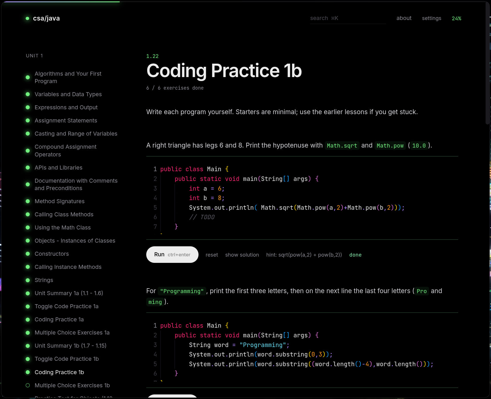

# CSAwesome Improved



Interactive AP CS A (Java) lessons with an in-app code editor and Java runner.

## Download

Windows users: grab the installer (`.exe`) from the [Releases](../../releases) page. A JDK (`javac` on PATH, e.g. [Adoptium](https://adoptium.net)) must be installed to run code.

## Requirements

- Node.js 20+
- A JDK (`javac` and `java` on PATH). The runner compiles and executes your code locally.
- Desktop app: the system Electron (`/usr/bin/electron`, e.g. `pacman -S electron`).

## Run

```
npm install
npm run dev            # browser: Vite + Java API, open http://localhost:5173
npm run electron:dev   # desktop window against the Vite dev server
npm run start:system   # build, then run the desktop app (system Electron)
```

The desktop app starts the Java API itself (port 3001, or a free port if taken) and serves the built `dist/`.
`npm run build` typechecks and builds. `node scripts/selftest.mjs` (with the server running) checks every exercise solution.

Add content by creating `src/content/unitN.ts` (see `types.ts`) and registering it in `src/content/index.ts`.

## Attribution

Lesson structure adapted from [CSAwesome2](https://github.com/bhoffman0/CSAwesome2) by Beryl Hoffman et al.,
licensed under [CC BY-NC-SA 4.0](https://creativecommons.org/licenses/by-nc-sa/4.0/). This project is
likewise shared under CC BY-NC-SA 4.0 (non-commercial, share-alike); changes were made.
